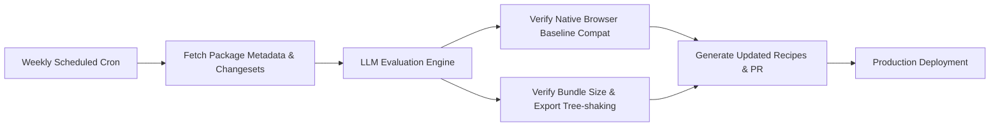

# Product Strategy & Architecture: Modernizing Trends & Launching "Bloat Busters"

## 1. Executive Summary & Context

Bundlephobia is the web's standard for JavaScript package size analysis. However, developers making dependency decisions rarely choose libraries solely on raw minified/gzipped bytes. When engineers evaluate competing packages or audit legacy codebases, they weigh architectural fitness, native web standard alternatives, transitive dependency risk, true maintenance health, and migration complexity.

This document outlines the product strategy and technical architecture to transform `/trends` into a comprehensive **Dependency Decision Engine** and introduce a dedicated **"Bloat Busters" / "You Might Not Need [X]"** platform.

---

## 2. Empirical Traffic Audit & The "Chrome 156/157" Discovery

### The Reality of Chrome 156 / 157
* **Release Verification**: In September 2026, Google Chrome moved to an accelerated 2-week release cadence starting with Chrome 153. Chrome 156 reached stable on October 20, 2026, followed by Chrome 157 on November 3, 2026. Chrome 156/157 represents the current modern consumer Chrome browser base.
* **Client Behavior & JavaScript Execution**:
  Deep inspection of the HAProxy access logs reveals that visits with Chrome 156/157 user agents:
  1. Trigger full client-side Next.js data hydration (`/_next/data/...`).
  2. Fire post-render Amplitude analytics telemetry (`/_events`).
  3. Arrive via contextual deep comparison links (`/trends?packages=pkgA~vs~pkgB~vs~pkgC`) linked from the `SimilarPackagesSection` on package pages and sitemaps.
* **Why the Preamble Appeared Truncated**:
  HAProxy variable interpolation and proxy pipeline normalization can capture the trailing browser token rather than the full synthetic string, creating an initial illusion of malformed scraper headers.
* **Takeaway**: A significant cohort of `/trends` traffic represents **real headed browsers and automated search previewers executing JavaScript**, landing directly on deep comparison URLs with high intent.

---

## 3. Core Evaluation Dimensions: What Developers Actually Care About

When software architects and engineers debate dependencies on Reddit (`r/reactjs`, `r/webdev`), Hacker News, and GitHub RFCs, decision-making clusters around five core dimensions beyond bundle size:

```
┌────────────────────────────────────────────────────────────────────────┐
│                   THE 5 DEPENDENCY DECISION DIMENSIONS                 │
├────────────────────────────────────────────────────────────────────────┤
│ 1. "You Might Not Need [X]"  │ Native browser / Node.js web standards │
│ 2. Architectural Physics      │ Controlled vs uncontrolled, re-renders │
│ 3. Transitive Blast Radius    │ Zero-dep vs 40 nested packages         │
│ 4. Deep Maintenance Velocity  │ PR turnaround, ESM exports, TS decay   │
│ 5. Migration & Rip-Out Cost   │ Proprietary lock-in vs AST codemods    │
└────────────────────────────────────────────────────────────────────────┘
```

### Dimension 1: "You Might Not Need [X]" (Native Web Standards at 0 kB)
The strongest movement in modern JavaScript is dependency elimination using standard platform features:
* **HTTP / Data Fetching**: Replacing `axios` with standard `fetch` + `AbortController` + native `Response.json()`.
* **Utility Libraries**: Replacing `lodash` methods with standard ECMAScript (`Object.groupBy`, `structuredClone`, `Array.prototype.toSorted`, `Array.prototype.flat`).
* **Date & Time**: Replacing `moment` with native `Intl.DateTimeFormat`, `Intl.RelativeTimeFormat`, and the TC39 `Temporal` API.
* **IDs & Crypto**: Replacing `uuid` with native `crypto.randomUUID()`.
* **UI Primitives**: Replacing custom modal/popup libraries with native `<dialog>` and the Popover API.

### Dimension 2: Architectural Model & Runtime Physics
* **Re-render Cascades**: In libraries like *React Hook Form vs Formik*, bundle size difference is secondary to Formik's controlled input state re-rendering entire component trees on every keystroke versus uncontrolled ref-based registration.
* **Event Loop & Memory Footprint**: Evaluating whether a library allocates temporary objects in hot loops or blocks the main thread during hydration.
* **Modern Framework Primitives**: First-class compatibility with React Server Components (`'use client'` boundary clarity), Streaming SSR, and Signals.

### Dimension 3: Transitive Dependency Blast Radius & Security Incidents
* **Direct vs Transitive Footprint**: A 3 kB library that pulls in 15 sub-dependencies introduces supply-chain vulnerabilities, install bloat, and version deduplication failure in monorepos.
* **The Zero-Dependency Premium**: Developers heavily favor packages with **0 dependencies** (e.g., `zustand`, `nanoid`, `date-fns`, `radash`) because they guarantee isolated blast radius and clean `node_modules`.
* **Historical Security Vulnerability Track Record**:
  * Developers deeply distrust packages that have a history of repeated Critical/High CVEs (e.g., Prototype Pollution in legacy utility libraries, SSRF in HTTP clients, ReDoS in regex matchers).
  * Surfacing the **historical security track record**—not just active vulnerabilities, but how frequently security incidents occur and how rapidly maintainers patch them—is a decisive indicator of engineering maturity.
* **Current Gap**: The comparison table on `/trends` does not currently surface transitive dependency count, total disk footprint, or security incident history. Adding these immediately answers primary engineering questions.

### Dimension 4: Deep Maintenance Velocity & Abandonment Signals
Conventional metrics like GitHub stars and last-commit timestamps are notoriously shallow—a dead package can boast 50,000 stars, and a single chore commit bumping a readme hides an abandoned codebase. True health indicators include:
* **Maintainer Responsiveness**: Median time to first maintainer response on open issues and PRs over the last 90 days.
* **Unmerged Security PR Ratio**: Number of dependabot/security PRs languishing unmerged.
* **Packaging & Standards Hygiene**: Does the package provide valid ESM `"exports"` maps, Dual CJS/ESM compatibility, or does it trigger module resolution errors in Vite/Turbopack?
* **TypeScript Quality & Types Drift**: Is TypeScript authored natively with strict types, or outsourced to community `@types/*` that break on minor version bumps?
* **Bus Factor & Sponsoring**: Is maintenance sustained by a corporate team, a multi-maintainer collective, or a lone volunteer at risk of burnout?

### Dimension 5: Migration & "Rip-Out" Cost (Vendor Lock-in)
* **Proprietary DSL vs Idiomatic Composition**: Libraries that require custom DSLs or invasive wrappers (e.g., complex Redux boilerplate) are high-risk; if the library is abandoned, refactoring is costly.
* **API Invariance**: Libraries adhering to standard patterns (e.g., `date-fns` using native `Date` objects and pure functions) can be swapped or refactored with minimal blast radius.
* **Automated Codemod Availability**: Feasibility of migrating using jscodeshift / AST codemods.

---

## 4. Product Surface: "Bloat Busters" / "You Might Not Need [X]"

### Concept & User Journey
"Bloat Busters" is an interactive, searchable portal dedicated to helping developers shed unnecessary client-side JavaScript. It merges the philosophy of the classic *You-Dont-Need* repos with Bundlephobia's live bundle metrics and interactive migration tools.

### Core Features

#### 1. Search by Package or Functional Task
Users can find alternatives by searching either:
* **The Package Name**: e.g., `moment`, `lodash`, `axios`, `faker`, `classnames`, `numeral`.
* **The Common Web Standard / Task**: e.g., "date formatting", "deep copy", "query string parsing", "class merging", "http request".

#### 2. Side-by-Side Modern Alternatives & Native Replacements
Each entry provides a 3-way breakdown:
1. **The Legacy Bloat Culprit**: Bundle size, dependency count, legacy pain points.
2. **The Modern Lightweight Package**: Drop-in or near drop-in replacement with size delta (e.g., `moment` -> `dayjs`, `lodash` -> `es-toolkit`).
3. **The Native Web Platform Way (0 kB)**: Standard Web API / ECMAScript alternative with code snippet.

#### 3. Interactive Before/After Code Recipes
Side-by-side executable code tabs demonstrating exact syntax translation:
```typescript
// Legacy: Moment.js (72 kB)
import moment from 'moment'
const formatted = moment().subtract(3, 'days').calendar()

// Modern Lightweight: Day.js (2.9 kB)
import dayjs from 'dayjs'
import calendar from 'dayjs/plugin/calendar'
dayjs.extend(calendar)
const formatted = dayjs().subtract(3, 'days').calendar()

// Native ECMAScript (0 kB)
const rtf = new Intl.RelativeTimeFormat('en', { numeric: 'auto' })
const formatted = rtf.format(-3, 'day')
```

#### 4. "Drop Your package.json" Audit Scanner
A drag-and-drop or paste input allowing developers to upload their project's `dependencies` section (or upload `package.json` / `package-lock.json` directly). The client-side scanner immediately produces a 3-part audit:
1. **Bloat Analysis**:
   * Scans for known legacy heavyweights (`moment`, `lodash`, `axios`, `crypto-js`, `faker`, etc.).
   * Calculates **Total Potential Bundle Reduction** (e.g., *"You can eliminate 142 kB gzip across 4 packages"*).
   * Displays modern drop-in replacements and native Web API alternatives.
2. **Security Posture & Incident History**:
   * Cross-references installed versions and package names against **OSV.dev**.
   * Flags both currently active CVEs and packages with chronic vulnerability histories.
3. **Transitive Dependency Tree Footprint**:
   * Warns when installed packages drag in excessive transitive dependency chains.
4. **Export & Actionable Output**:
   * Generates a single-command migration recipe: e.g. `npm uninstall moment axios && npm install dayjs ky`.
   * Generates a copyable Markdown audit table for pull requests and Slack.

#### 5. "You Might Not Need..." Blog Series
A recurring, deeply researched editorial series published on `/blog`:
* *You Might Not Need Moment.js in 2026: The Modern Guide to Temporal and Intl*
* *You Might Not Need Lodash: 25 Native JavaScript Replacements*
* *You Might Not Need Axios: Modern Fetch Patterns with Ky and Wretch*
* *Zero-Dependency State Management: From Redux to Zustand and Signals*

---

## 5. Enhancements to the Trends Page (`/trends`)

1. **Transitive Dependency Tree in Comparison Table**:
   Display direct vs transitive dependency counts for every compared package alongside minified and gzipped sizes.
2. **Historical Security Incidents & Vulnerability Graph**:
   * **Data Source**: Integrated with Google's **OSV.dev REST API** (`api.osv.dev/v1/query`), which aggregates the GitHub Advisory Database, NIST NVD, and ecosystem-specific advisories without authentication limits.
   * **Chart Visualization**:
     * A toggleable timeline view on `/trends`: **"Security Incidents Over Time"** (cumulative CVEs plotted chronologically by publication date).
     * Vulnerability milestone pins directly on the timeline chart (indicating Critical/High/Moderate CVE disclosures and subsequent patch releases).
   * **Comparative Incident Scorecard**:
     * Total historical vulnerabilities (e.g., `Axios`: 56 CVEs vs `Ky`: 1 CVE; `Lodash`: 10 CVEs vs `es-toolkit`: 0 CVEs; `Zustand`: 0 CVEs vs `Redux`: 0 CVEs).
     * Severity breakdown: Critical / High / Medium / Low.
     * Patch Velocity: Mean time from CVE disclosure to patched release.
3. **Deep Maintenance Diagnostic Scorecard**:
   Replace simplistic stars with:
   * Maintainer PR turnaround time (< 7 days / < 30 days / stagnant).
   * Modern bundler compatibility badge (ESM `"exports"` verified).
   * First-class TypeScript badge.
3. **"Copy Comparison for GitHub PR / RFC"**:
   A single-click button producing pre-formatted Markdown tables for pull requests and engineering proposals.
4. **Contextual Pathways from Package Pages**:
   Add a prominent above-the-fold banner on package detail pages:
   > *"Considering alternatives to Moment.js? Compare size and momentum with Day.js & Date-fns →"*

---

## 6. Automated Maintenance Pipeline (Weekly LLM Curation Job)

To prevent code recipes, alternatives, and standards from going stale, the feature will be supported by an automated weekly background worker:



1. **Candidate Discovery**: Weekly check on trending npm packages in similar-package categories and new releases of tracked Bloat Culprits.
2. **LLM Verification Agent**:
   * Evaluates breaking API changes in new major releases.
   * Cross-references browser support tables (MDN / Baseline) for native Web APIs.
   * Validates code snippets for syntax correctness and drop-in compatibility.
3. **Automated Pull Request**: Emits structured JSON updates to `trendsRecommendations.json` and `bloatBustersCatalog.json` via automated PR for quick maintainer review.
